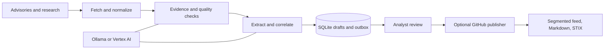

# threat-bot

**Turn security reporting into reviewable threat intelligence.**

threat-bot collects advisories, research, detection content, and optional social signals; extracts structured facts with a local or hosted language model; and keeps drafts in SQLite for review. An optional GitHub publisher produces a versioned feed with Markdown and STIX 2.1 projections.

Use it to run your own intelligence workflow, inspect the evidence behind a draft, and publish a feed you control. Generated claims, ATT&CK mappings, and detection content need analyst review. This is pre-1.0 software; a synthetic regression suite is included, but it is not a live-model accuracy benchmark.

## Start locally

You need Git, **Go 1.27.4**, and a running [Ollama](https://ollama.com/) server for live processing. From this checkout:

```sh
make build
cp config.example.yaml config.yaml
./threat-bot -config config.yaml config validate
./threat-bot version
```

Those checks do not contact a model or create a database. To try the example model, download it with Ollama and check the connection:

```sh
ollama pull qwen3:8b
./threat-bot -config config.yaml check-llm
./threat-bot -config config.yaml run
```

The example enables CISA KEV and keeps automatic publishing off. Live runs fetch public sources plus KEV/EPSS enrichment and send source content to the configured model. Ollama downloads use network and disk; local inference needs suitable memory and compute. Hosted providers can incur charges. The example model is a starting configuration, not a quality or hardware guarantee.

Stop with **Ctrl-C**, then inspect any drafts:

```sh
./threat-bot -config config.yaml drafts list
./threat-bot -config config.yaml drafts show DRAFT_ID
```

A quiet source or a rejected item can produce no drafts. For a deterministic first result without a model or provider credentials, run `go test ./cmd/threat-bot -run TestFirstRunFixtureCreatesDraftAndSurvivesRestart -count=1 -v` after downloading the Go dependencies. See the [full getting started guide](docs/getting-started.md) for expected results, storage, and troubleshooting.

## From source to feed



The pipeline tracks source identity, correlates updates, validates generated structures, and retains publication state for retries. Public Markdown is a deliberately smaller projection of a brief. The legacy `feed_public_key` wrapper **does not provide confidentiality or publisher signatures**: anyone holding the public value can derive its symmetric key. Read the [feed protocol](docs/feed-protocol.md) before publishing sensitive material.

A [synthetic brief](examples/brief.md) and [generated STIX example](examples/stix-bundle.json) illustrate the output without real incident data.

## Choose your next step

| Goal | Guide |
| --- | --- |
| Change sources, models, or paths | [Configuration](docs/configuration.md) · [Integrations](docs/integrations.md) |
| Review drafts or recover publication | [Commands](docs/commands.md) · [Operations](docs/operations.md) |
| Understand data, trust, and persistence | [Architecture](docs/architecture.md) · [Security model](docs/security-model.md) |
| Build or contribute | [Development](docs/development.md) · [Contributing](CONTRIBUTING.md) |
| Evaluate extraction or verify a release | [Evaluation](docs/evaluation.md) · [Releases](docs/releases.md) |

No cloud account, publisher credential, or sibling repository is needed for the default test suite. See [Support](SUPPORT.md) for scope and [Security](SECURITY.md) for private vulnerability reporting. Source preparation and a verified artifact release are separate milestones; this README does not assert that a release or public deployment has occurred.

## License

The repository retains the GNU Affero General Public License version 3 text in [LICENSE](LICENSE). Third-party code and data have their own notices; see [NOTICE.md](NOTICE.md). ATT&CK is a registered trademark of The MITRE Corporation. Project names and links do not imply endorsement.
